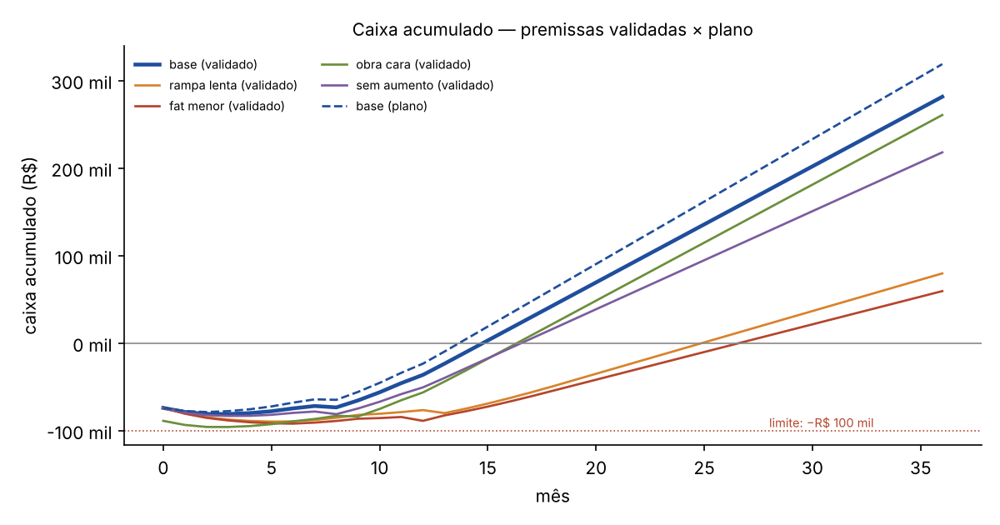

# 1. Recomendação

**AJUSTAR.** O salão é viável com os números pesquisados, mas com pouca folga. Não assine o aluguel antes de cumprir três condições: (1) ter as **2 cartas das âncoras com faturamento verificado**; (2) colocar no contrato de parceria que a **taxa do cartão é descontada antes da divisão**; (3) achar uma **sala que, com aluguel, condomínio e IPTU, caiba em até R$ 5,2 mil**, com o ar-condicionado dimensionado para ~60 mil BTU/h dentro do orçamento.

Com as premissas validadas, o caixa se paga no **mês 15**, o equilíbrio fica em **54,4% de ocupação** (teto de 55%) e o pior estresse isolado chega a **−R$ 95,8 mil** (limite de −R$ 100 mil). Os três critérios de viabilidade passam. O payback tem 3 meses de folga; o equilíbrio tem só 0,6 ponto percentual e o estresse só R$ 4,2 mil. Dois riscos encontrados na pesquisa, cada um sozinho, derrubam algum critério: o salão absorver a taxa cheia do cartão e o estouro do ar-condicionado.

> **Limites desta rodada.** Várias frentes dependem de fontes que este ambiente não consegue acessar sem burlar bloqueios: portais imobiliários, Google Maps, Instagram e algumas páginas do IBGE e da Prefeitura. Não houve contato com pessoas (regra 6). As frentes F2, F3, F5, F6, F7 e F14 estão **incompletas**, e as mensagens para fechá-las estão em `mensagens/`. Nenhum número foi inventado: campo sem fonte está marcado "a confirmar", e estimativa traz o método.

# 2. Região e salas recomendadas para visita

- **Demanda (F1):** as duas regiões têm público para 8 postos. No raio de 800 m, **Copacabana precisa de 2,0–4,2% do gasto local e a Tijuca de 2,8–5,3%**. Copacabana passa com folga; a Tijuca fica no limite de 5% se o gasto não for ajustado pela renda. Copacabana também fica a ~1,9 km do Largo dos Leões, contra ~4,4 km da Tijuca. A decisão do plano (Tijuca como padrão) continua de pé, mas **Copacabana ficou à frente nos números de mercado e de deslocamento**.
- **Salas (F3):** ainda **não há 3 salas que passem nos eliminatórios**. Os portais bloqueiam coleta automática, e o FipeZAP mostra aluguel médio de R$ 57,51/m² no Rio, com alta de 21% em 12 meses. Os poucos anúncios vistos dão um total de R$ 4,5–6,5 mil para 65–75 m². Os 40 anúncios por região ficam com o Thomás (`mensagens/imobiliaria.md`).

# 3. Orçamento de abertura contra os R$ 74 mil

| Item | Plano | Pesquisado | Situação |
|---|---|---|---|
| Reforma e adequação | 20.000 | a confirmar (F6) | sem orçamento |
| Móveis e equipamentos (fase 1) | 28.000 | **23.832 em 8 de 31 itens** | risco de estouro: ar subdimensionado (~61 mil BTU/h necessários) |
| Legalização, projeto e licenças | 4.000 | homologação de R$ 1.800/ano + taxas a confirmar | provável dentro |
| Identidade visual, fotos e lançamento | 4.000 | ~4.000 (F13) | dentro |
| Estoque inicial | 6.000 | a confirmar (F7) | — |
| Seguro-fiança ou caução | 5.000 | depende do aluguel (≈ 1 mês de R$ 5,2 mil) | justo |
| Custos antes de abrir | 5.000 | a confirmar | — |
| Reserva para imprevistos | 2.000 | — | — |
| **Montagem** | **74.000** | **não fechado** | estouro provável de ~R$ 4–8 mil (ar e itens que faltam) |

# 4. Tabela de preços proposta
Provisória e só de unhas (F2). Até agora só 3 concorrentes publicam preços. Mão e pé: **R$ 69–75** (Tijuca R$ 64–81; mediana das capitais R$ 60). Esmaltação em gel: **R$ 80–85** (Tijuca R$ 75–85; mediana R$ 70). Cabelo e estética **dependem da coleta da Manon** (`mensagens/salao_cliente.md`). O `fator_preco` de 1,08 segue sem validação.

# 5. Custos fixos validados contra o plano

| Linha | Plano | Pesquisado |
|---|---|---|
| Aluguel, condomínio e IPTU | 4.200 | **~5.200** (estimativa FipeZAP + anúncios) |
| Energia | (no total) | **~2.160** (1.848 kWh × R$ 1,17) |
| Recepcionista fixa | 2.900 | **2.913** (CCT Rio: piso R$ 1.726,81 + encargos + auxílio-alimentação) |
| Recepção intermitente | 900 | 900 (≈ 13 turnos de 4 h) |
| Homologação dos contratos | — | **+150** |
| Sistema | (no total) | 110–250 |
| **Fixos da fase 1** | **8.700** | **~9.700** (validado); as linhas cotadas já somam ~9.270 antes de 8 linhas |

Critério "custo fixo da fase 1 ≤ R$ 9,6 mil": **falha provável**.

# 6. Resultado do simulador

| Caso | Pior caixa | Payback (mês) | Lucro maduro (margem) | Equilíbrio | Pior estresse isolado |
|---|---|---|---|---|---|
| Plano | −78.746 (mês 2) | 14 | 14.274 (18,3%) | 50,7% | −93.546 |
| **Validado** | **−81.023 (mês 3)** | **15** | **13.257 (17,0%)** | **54,4%** | **−95.823** |
| Validado, salão absorve a taxa de cartão cheia | −81.665 | 16 | 12.604 (16,1%) | **55,6% ✗** | −96.465 |
| Validado com aluguel do plano (R$ 4,2 mil) | −78.962 | 14 | 14.257 (18,2%) | 51,0% | −93.762 |
| Validado com aluguel de R$ 6,2 mil | −84.023 | 16 | 12.257 (15,7%) | **57,8% ✗** | −98.823 |
| Validado + equipamentos e ar +R$ 6 mil | −87.023 | 16 | 13.257 (17,0%) | 54,4% | **−103.023 ✗** |

Estresses com as premissas validadas: rampa lenta, payback no mês 25 (dispara a revisão do mês 6); faturamento menor, mês 27 (revisão); obra cara, mês 17; sem aumento de preço, mês 17; **tudo junto: parada no mês 6**.

Sensibilidade (validado): com faturamento por cabeleireira de R$ 10 mil, o payback vai para o mês 18 (limite); com R$ 8 mil, mês 24 e lucro maduro de R$ 7,1 mil. **O faturamento das âncoras é a premissa que mais pesa**, por isso o portão das cartas vem antes de tudo.

Alavancas (efeito no lucro maduro validado): repasse calibrado, +R$ 4.267; segundo turno, +R$ 2.984; horas ociosas, +R$ 866; PIX como padrão, +R$ 689; varejo maior, +R$ 624; varejo no Anexo I, +R$ 191; aluguel escalonado, R$ 0 no maduro (ajuda só no 1º ano). No salão maduro, perder uma destas alavancas leva o equilíbrio para cima de 55%: repasse calibrado (63,7%), horas ociosas (57,4%) e PIX como padrão (55,7%).

# 7. Premissas que mudaram

| Premissa | Plano | Validado | Efeito | Confiança |
|---|---|---|---|---|
| Aluguel + condomínio + IPTU (em `fixos_fase1/2`) | 4.200 | 5.200 | −R$ 1.000/mês no lucro; equilíbrio +3,4 pp | baixa |
| `fixos_extras` (homologação) | 450 | 600 | −R$ 150/mês | alta |
| `taxa_cartao` | 2,0% da cota | 1,6% (com cláusula) / 3,4% (sem cláusula) | +R$ 145/mês com a cláusula; −R$ 650/mês sem ela | média |
| `recepcionista_fixa` | 2.900 | 2.913 | neutro | alta |
| Tabelas do Simples 2026 | — | confirmadas | neutro em 2026; 2027 em aberto (LC 214/2025) | alta |
| Demais (preço, faltas, produtos, varejo, horas ociosas, segundo turno, obra, equipamentos) | — | mantidas | não validadas nesta rodada | baixa |

Arquivo: `simulador/premissas_validadas.yaml` (valor, fonte, confiança e justificativa por premissa). Planilhas: `simulador/saida/simulacao.xlsx` (plano, com aba Comparação) e `simulacao_validada.xlsx`.

# 8. Critérios de decisão (seção 4 do briefing)

| Critério | Limite | Resultado | Status |
|---|---|---|---|
| Âncoras | 2 cartas, ≥ R$ 10 mil/mês verificado | não verificado (Manon) | **pendente — portão** |
| Sala | ≥ 1 sala nos eliminatórios, ≤ R$ 4,5 mil | nenhuma ainda; mercado em ~R$ 5,2 mil | **falha provável** → ajustar teto ou metragem |
| Obra | ≤ R$ 25 mil | sem orçamento | pendente |
| Equipamentos | Fase 1 ≤ R$ 28 mil | R$ 23,8 mil em 8 de 31 itens; ar subdimensionado | **risco alto** → usados, ar dimensionado, adiar o posto de estética |
| Licenças | atividade permitida; ≤ R$ 5 mil | baixo risco; taxas a confirmar; CPL do endereço | provável |
| Preço | mediana + 8% ≤ P75 | só unhas, 3 concorrentes | pendente |
| Custo fixo | Fase 1 ≤ R$ 9,6 mil | ~R$ 9,7 mil | **falha provável** → cortar o não essencial ou aceitar com o aluguel |
| Mercado | fatia ≤ 5% | R2 2,0–4,2%; R1 2,8–5,3% | **passa** (Tijuca no limite) |
| Viabilidade | payback ≤ 18, equilíbrio ≤ 55%, estresses > −R$ 100 mil | 15 / 54,4% / −95,8 mil | **passa, sem folga** |

**Correção proposta para os critérios que falham:** (a) aceitar até R$ 5,2 mil de custo total da sala **só com** a cláusula do cartão e o escalonamento no 1º ano; (b) enxugar os fixos não essenciais (marketing recorrente de R$ 1,2 mil para R$ 900 depois do mês 4; auxílio-alimentação dispensado com copa própria, −R$ 580 na fase da recepcionista fixa); (c) limitar os equipamentos a R$ 28 mil comprando usado e adiando a maca e a autoclave classe B se a Vigilância aceitar classe N. Com (a) e (b) (marketing −R$ 300/mês e recepcionista sem auxílio-alimentação, R$ 2.331), o equilíbrio cai para **51,4%**, o payback fica no mês 15 e o lucro maduro vai a R$ 14,1 mil. O pior estresse continua em −R$ 95,2 mil, e com equipamentos +R$ 6 mil chega a −R$ 102,4 mil. Por isso (c), segurar os equipamentos em R$ 28 mil, é obrigatório.

# 9. Riscos novos encontrados na pesquisa
1. **Aluguel comercial no Rio subindo 21% em 12 meses** (FipeZAP): pressão no ponto e no reajuste anual.
2. **Ar-condicionado**: a carga térmica estimada (~61 mil BTU/h) é ~25% maior que a de 2 aparelhos de 24 mil; mais custo de compra, de energia e talvez quadro trifásico.
3. **Energia**: ~R$ 2,2 mil/mês estimados, linha grande e sem detalhe no plano.
4. **Taxa de cartão**: se o contrato não a descontar antes da divisão, o equilíbrio passa de 55%.
5. **Homologação sindical obrigatória** dos contratos de parceria no Rio (custo anual e prazo).
6. **Teto do MEI das parceiras**: âncora com R$ 10 mil+/mês fatura R$ 120 mil+/ano e não cabe no MEI (R$ 81 mil; R$ 110 mil em 2027 se sancionado). Ela precisa ser ME.
7. **Reforma tributária a partir de jan/2027**, já no 1º ano de operação.
8. **CCT vencida em 30/09/2026**: piso e auxílio devem ser reajustados.

# 10. Próximos passos

| Quando | O quê | Quem |
|---|---|---|
| até 30/11/2026 | Preços de 15+ concorrentes por região (cabelo primeiro) | Manon |
| até 30/11/2026 | 50 respostas do questionário | Manon |
| até 30/11/2026 | 40 anúncios por região + mensagem às 8 melhores imobiliárias | Thomás |
| até 18/12/2026 | **Portão:** 2 cartas das âncoras com extratos verificados | Manon |
| dez/2026 | Visitar as 3 salas; orçamentos de obra; CPL da escolhida | Thomás e Manon |
| dez/2026 | Cotações de equipamentos (ar primeiro), 3 contadores, parecer | Thomás |
| jan/2027 | Condições de 3 marcas; seguros; ECAD | Thomás |
| jan/2027 | **Rodada 2:** preencher os "a confirmar", rodar o simulador de novo e reavaliar os critérios | analista |
| fev/2027 | Empresa e sala (só se o portão das âncoras passar) | Manon e Thomás |

Tarefas e textos prontos: `mensagens/README_tarefas.md`.

# 11. Fontes
78 fontes, com link, órgão ou site, tipo e data de acesso, em `dados/fontes.csv`. Principais: IBGE/IPP (Censo 2022 por setor), IBGE POF 2017-18 (SIDRA 6715), BCB (IPCA), FipeZAP Comercial 2026, CCT SEMPRIBEL-RJ/SINBEL-RJ 2025/26, carioca.rio (CPL e alvará), CBMERJ (NT 1-07), ANEEL (Light 2026), Resoluções CGSN 137/2017 e 140/2018, vitrines públicas do Trinks e da Unhas Cariocas, Irrivio/Booksy (preços de 6 capitais).
